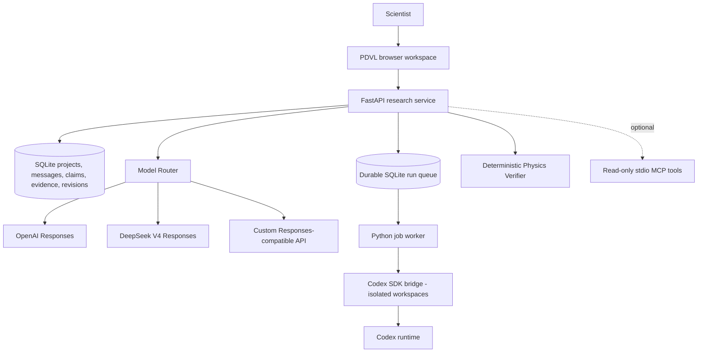

# PDVL Studio: independent system architecture

The **research state belongs to this GitHub project**. Neither a ChatGPT conversation nor a Codex thread is the source of truth. Keep provider, orchestration, storage and physics verification independent.

## Separation by capability, not brand

**Inference provider adapter**: text/reasoning interaction, native Responses. Do not assume server-side tool availability is uniform between OpenAI and DeepSeek. `configs/models.json` maps human-readable model aliases to actual provider IDs. The public UI picker shows missing keys but never exposes secrets.

**Agent runtime adapter**: Codex is currently first. It is treated as a distinct *harness* that may itself use OpenAI or DeepSeek models. Future providers such as OpenCode, Pi, or dedicated physics agents should implement the same task-to-artifact contract, NOT replace the research database.

**Scientific state**: Append evidence. Store claims with assumptions and formal status; a draft or LLM sentence is an idea, not automatically verified. Keep model outputs and traces separate from accepted scientific evidence. Codex emits local files and final text but does not auto-promote claims.

**Research modes**: Discuss and Write use separate *editorial contracts* from Investigate and Verify. The system must never force a technical feasibility-report format into manuscript prose.

## Research context → artifacts → evidence → manuscript

`pdvl/research.py` builds the canonical project snapshot for chat, research briefs and agent tasks. It includes claims, evidence, decisions, latest manuscript revisions, previous run summaries, artifact metadata and the latest 16 project messages. Model prompts receive bounded sections; the full task snapshot is frozen in `runs.context_json` when queued and copied into `RESEARCH_CONTEXT.json` for the agent. Later project edits do not change that task's input.

The worker archives original question/context bytes, response, event/stderr logs and regular workspace files (excluding `.git`) in the SQLite `artifacts` table. Each artifact has a run ID, relative name and SHA-256. Downloads and research tools read these archived bytes, never a mutable workspace path. Symlinks are rejected, and the combined archive is limited to 10 MiB per run; an archive failure marks the run failed. Failed executions can still retain inspectable artifacts. SQLite backups now include archived bytes as well as research records.

Users explicitly register an artifact against a claim through `POST /api/projects/{pid}/evidence` with `artifact_id`, an interpretation and a verdict. `evidence.artifact_id` is the source relation; the service records the archive hash, run/model identity and context hash in provenance. A supporting interpretation does not change the claim's scientific status. There is no automatic evidence creation from an agent response.

Manuscripts cite sources inline as `[evidence:e_...]`. Saving extracts and validates those IDs against the same project and derives `revisions.evidence_refs`; clients do not submit a parallel reference list. An unknown or cross-project citation rejects the entire revision. Each returned revision includes resolved `sources` linking evidence → claim → artifact → run; prior revisions retain their own citations. Investigate, Verify and Write can use the read-only `read_research_artifact` tool to inspect archived UTF-8 source text (bounded to 8,000 characters, with a truncation flag). Binary artifacts remain downloadable.

Startup adds the artifact table and the two new columns to existing databases without rewriting research records. Historical references remain stored. Previously queued tasks without a context snapshot fail explicitly and must be recreated; no present-day context is silently substituted for a missing historical input.

## Task progress, cancellation and continuation

The worker consumes JSONL events while Codex executes. `thread.started` immediately saves the thread ID; selected agent messages, command starts/completions and file changes are appended to `run_events`. Raw events remain in the archived trace. `GET /api/runs/{rid}/events?after=N` returns at most 100 entries plus a cursor and `has_more`. The page polls active tasks once per second, appends progress without rebuilding editable forms, and stops polling when tasks finish, the project/mode changes or the page is hidden. Reopening the page loads persisted progress.

`POST /api/runs/{rid}/cancel` atomically changes `queued → cancelled` or `running → cancelling`. The worker runs the bridge in its own POSIX process group, requests termination (the bridge also aborts its SDK stream), and escalates after two seconds if necessary. The worker waits for termination and archives partial files before publishing `cancelled`. Timeouts use the same process cleanup. Graceful worker shutdown finalizes active work as `interrupted`; startup finalizes records left active by a previous worker. This is a single-worker local runtime, not a multi-host task broker.

`POST /api/runs/{rid}/continue` accepts a new `message` after a task has stopped and has a saved thread ID. It freezes fresh project context and creates a child run with `parent_run_id`, the same model and thread ID, and a new workspace restored from the prior archive. An unstarted cancelled continuation has no workspace, so restoration follows its parent to the last actual execution. Files intentionally absent from an executed run are not recovered from older runs. Each run can have one child; a unique SQLite index prevents duplicate/concurrent continuation requests. Users continue the latest child rather than branching a shared Codex session.

Continuation is the sole resume entry point; arbitrary `thread_id` input on new task creation was removed. It never rewrites the parent's artifacts, evidence or revisions. The only new storage is the progress table and a self-referencing parent column on `runs`; there is no separate broker or streaming service.

## Isolated agent provider configuration

`PDVL_HOME/codex/config.toml` is the single model/provider configuration for new Codex tasks. The supported authentication path is an explicit Responses provider with `env_key` and `requires_openai_auth=false`. The worker supplies a small child environment containing the selected API-key variable and OS/process essentials. Both `CODEX_HOME` and `CODEX_SQLITE_HOME` point to this private directory; inherited app session/credential overrides are excluded. The bridge pins ephemeral credential storage and the frozen provider settings, disables shell snapshots that could persist keys, and restricts command environment inheritance to core OS variables. Nothing writes to the ordinary Codex configuration or auth store.

`runs.context_json.codex_runtime` freezes non-secret provider metadata alongside research state. This reuses the snapshot instead of adding another config table or API secret field. The worker retains the frozen model even if the default changes after queuing. A changed credential destination (provider/base URL/key variable/home) rejects the queued execution before passing a key to a CLI. Model-prefix guessing and `PDVL_CODEX_MODEL` were removed. The UI shows the configured model; the task API no longer accepts model overrides. Missing configuration or authentication fails explicitly.

Continuation compares the parent's frozen runtime with the current profile before queueing. Historical sessions without this metadata and sessions from another provider/model/home cannot cross into the new runtime. Their scientific records remain readable. The run list exposes `runtime_matches` so the page hides unavailable continuation controls. Local CLI session state lives in the private Codex home; the research database archive preserves evidence bytes, not a portable replacement for the CLI session store.

## Scientific review protocol

A test must declare the **class of claim** it checks. The RG-difference verifier is valid for one algebraic identity under common anomalous dimension; it does not confirm a generic user claim, cross-process observability, finite-resolution phenomenology or uniqueness of an inverse reconstruction. No silent promotions beyond a canonical seeded claim with known statement and a narrow formal test.

## Durability and upgrades

- SQLite persists state through browser or app restarts; `pdvl backup` uses a consistent SQLite backup API.
- Each model response logs its alias and provider metadata where available. Some provider aliases resolve to changing snapshots; reproducibility requires storing the model identity reported by provider and updating controlled aliases only after testing.
- Codex task logs, sanitized stderr and workspaces live under `.local/runs/`. They are intentionally not committed to public GitHub.
- Runtime archives, Python requirements and the Codex SDK/CLI are pinned; offline and packaged smoke tests validate updates. Model registry changes require explicit review and at least the seed benchmark before adoption.
- Adding a new provider should require editing `configs/models.json` plus adding a provider adapter if its protocol differs, not rewriting the scientific application.

## Roadmap without architectural rewrites

1. New tool plugins: arXiv/INSPIRE original-paper citations, PDF equation anchors, Mathematica/FORM, HDF5/ensemble metadata, interactive fit notebooks.
2. User-approved HPC adapter: production directory allowlist, PBS/SLURM dry-run, explicit resource budget and approval tokens, auditable submits.
3. Multi-worker scheduling: add a dedicated broker only if concurrency grows beyond the current local SQLite worker.
4. Dedicated desktop app or polished LaTeX editor: can reuse API and research state; requires no change to the inference/provider core.
5. Multi-user deployment would require proper authentication, access control, encrypted secrets, per-project isolation and audit policies; **not supported by this local-only scaffold**.

## Intel desktop distribution

The native AppKit launcher starts the existing service using bundled runtimes. `pdvl.desktop` owns one backend/worker pair and a data-directory process lock; a second copy opens the existing service without rewriting adapters. Settings are saved atomically through stdin and regenerated into the existing chat/Codex configuration paths. An app-specific data root separates configuration, logs, CLI sessions and research state from both the read-only application bundle and the source checkout. Changing settings or quitting shuts down the worker before the server exits, retaining normal archival semantics. See [macOS Intel build contract](MACOS_INTEL.md) for source allowlists, relocation checks and release provenance.
