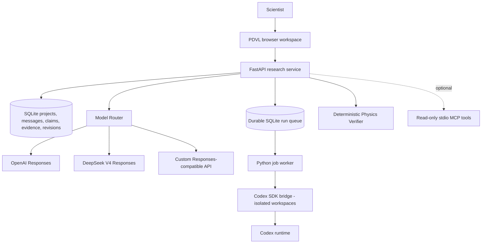

# PDVL Studio: independent system architecture

The **research state belongs to this GitHub project**. Neither a ChatGPT conversation nor a Codex thread is the source of truth. Keep provider, orchestration, storage and physics verification independent.

## Separation by capability, not brand

**Inference provider adapter**: text/reasoning interaction through native Responses or Chat Completions. Do not assume server-side tool availability is uniform between providers. `configs/models.json` maps human-readable model aliases to actual provider IDs. The public UI picker shows missing keys but never exposes secrets.

**Agent runtime adapter**: Codex is currently first. It is treated as a distinct *harness* that may itself use OpenAI or DeepSeek models. Future providers such as OpenCode, Pi, or dedicated physics agents should implement the same task-to-artifact contract, NOT replace the research database.

**Scientific state**: Append evidence. Store claims with assumptions and formal status; a draft or LLM sentence is an idea, not automatically verified. Keep model outputs and traces separate from accepted scientific evidence. Codex emits local files and final text but does not auto-promote claims.

**Research modes**: Discuss and Write use separate *editorial contracts* from Investigate and Verify. The system must never force a technical feasibility-report format into manuscript prose.

## Research context → artifacts → evidence → manuscript

`pdvl/research.py` builds the canonical project snapshot for chat, research briefs and agent tasks. It includes claims, evidence, decisions, latest manuscript revisions, previous run summaries, artifact metadata and the latest 16 project messages. Model prompts receive bounded sections; the full task snapshot is frozen in `runs.context_json` when queued and copied into `RESEARCH_CONTEXT.json` for the agent. Later project edits do not change that task's input.

The worker archives original question/context bytes, response, event/stderr logs and regular workspace files (excluding `.git`) in the SQLite `artifacts` table. Each artifact has a run ID, relative name and SHA-256. Downloads and research tools read these archived bytes, never a mutable workspace path. Symlinks are rejected, and the combined archive is limited to 10 MiB per run; an archive failure marks the run failed. Failed executions can still retain inspectable artifacts. SQLite backups now include archived bytes as well as research records.

Users explicitly register an artifact against a claim through `POST /api/projects/{pid}/evidence` with `artifact_id`, an interpretation and a verdict. `evidence.artifact_id` is the source relation; the service records the archive hash, run/model identity and context hash in provenance. A supporting interpretation does not change the claim's scientific status. There is no automatic evidence creation from an agent response.

Manuscripts cite sources inline as `[evidence:e_...]`. Saving extracts and validates those IDs against the same project and derives `revisions.evidence_refs`; clients do not submit a parallel reference list. An unknown or cross-project citation rejects the entire revision. Each returned revision includes resolved `sources` linking evidence → claim → artifact → run; prior revisions retain their own citations. All four modes can inspect archived source text through `read_research_artifact`, using an offset to continue beyond its 7,000-character chunks. Serialized tool results are kept intact rather than sliced into invalid JSON. Binary artifacts remain downloadable.

## Literature search, close reading and comparison

`pdvl/papers.py` owns arXiv metadata search, explicit-version PDF retrieval, PDF text extraction and the canonical source reader shared by the UI and model tools. The two import inputs are arXiv IDs/abs/pdf links and uploaded PDFs; arbitrary URL fetching is not supported. Metadata requests are serialized at three-second intervals. Retrieval failures remain explicit errors, not negative scientific findings.

An import is a completed `runs` record with `agent=literature` and no model identity. It archives `original.pdf` and `paper.json` (bibliographic metadata, original PDF hash/ID and ordered extracted page texts) through the same artifact writer as Codex. No literature table, vector database, alternate evidence ledger or agent execution is added. Reimporting identical PDF bytes in a project reuses its archive. New arXiv versions retain separate sources. Literature imports appear in the paper library rather than the Codex queue; snapshots include paper metadata without embedding entire PDFs.

The reader supports PDF page positions, character offsets within a page, and keyword searches returning matching page snippets. Original-page Markdown links open the same project-scoped reader in the page; the original PDF is downloadable for equation/figure inspection. Chat metadata records selected paper IDs and actual read-page/offset traces. Discuss exposes literature/claim-reading tools and the archive-only import operation, but cannot run named physics checks. The provider enforces the advertised tool allowlist, shares argument/result handling between its two protocols, and reserves its eighth model call for a final answer identifying any unread scope.

The UI selects one paper for close reading or two for comparison; selected papers are validated against the project before inference. Reading/importing never creates claims or evidence. Users explicitly attach an archived paper to a claim with `kind=literature`, an interpretation, verdict and PDF page number. The service validates page bounds and derives the original PDF identity from the archive. Those evidence IDs use the existing manuscript revision/citation path. An original-page link identifies a source; it is not an accepted evidence record or a proof.

The initial scope is text-layer PDFs of at most 8 MiB and 150 pages, within the existing 10 MiB combined archive budget. Scanned/encrypted or unreadable files fail explicitly. Extraction does not reconstruct figures or guarantee mathematical typography; blank/garbled text and unexamined pages must not be described as a full-paper review. This feature uses the existing configured API, including Ollama, and does not change Codex/ChatGPT authentication or publish a desktop release.

## Streaming discussion and project retrieval

`POST /api/projects/{pid}/chat` is the single chat execution path for all four modes. It returns newline-delimited JSON (`start`, `progress`, `tool_start`, `tool_end`, `delta`, `done`). Both native provider adapters request upstream SSE; a shared loop assembles fragmented tool calls, applies the mode allowlist, emits actual tool activity, and retains the eight-round budget. There is no non-streaming provider fallback. Batch model evaluations collect the same streamed execution. Tool results, rather than internal model reasoning, determine the visible activity and read trace.

The UI displays incremental text as plain text, then renders sanitized Markdown only after the final citation check. `done` replaces provisional text with the authoritative saved answer. `POST /api/projects/{pid}/messages/{mid}/stop` cancels that request's producer and upstream HTTP stream; it is project scoped and idempotent after completion. Closing the connection or switching project/mode cancels the producer too. Completed, stopped and failed replies share the existing messages table, with state, partial text, tool hashes and read records in `meta_json`. Stopped/failed text is marked incomplete in both the UI and subsequent model context. A bounded queue applies backpressure. Active cancellation handles exist only in the single local server process; this is not a durable background chat queue, and an abrupt process kill can lose an active reply. Already committed source archives are retained when stopping. PDF parsing runs without DB writes in a thread; cancellation prevents subsequent archive writes even if that bounded parsing work finishes later.

Source checks parse actual Markdown links. Archived citations must identify a readable source in the same project and a real page, with a matching archive hash and nonempty read recorded in this turn or the last 16 messages of the same mode. Search excerpts and selected papers do not count as reading. The trace records page, character offset and length; reading a chunk does not establish that the entire page or paper was read. Evidence markers must refer to the same project's evidence records. Invalid links are disabled and their reasons are shown; unknown evidence markers cannot silently become manuscript citations. This validates source identity/access, **not** whether the cited passage semantically supports every statement. Existing historical messages are not rewritten.

`paper_fts` is a rebuildable SQLite FTS5 page index over the existing immutable `paper.json` archives. One transaction indexes newly imported pages; startup backfills older papers without duplication. `GET /api/projects/{pid}/papers/fulltext?query=...` and the `search_project_papers` model tool use the same implementation: literal Unicode words joined with OR, BM25 page ranking, at most eight bounded excerpts, and project filtering. The UI opens a hit in the canonical source reader. This is keyword RAG, without embeddings, a vector service or additional API credentials; it does not perform cross-language semantic matching, reliable Chinese word segmentation, equation reconstruction or general web search. For English papers use English technical terms. A zero-hit result never establishes a negative scientific finding.

`tests/fixtures/discuss_acceptance.json` fixes three synthetic papers and four question/page labels, including assumptions, pseudodata versus experimental extraction, a negative control and a finite-resolution limitation. Tests separate retrieval/page access from citation checks. HTTP/SSE and real loopback tests cover incremental delivery, fragmented UTF-8/tool arguments, cancellation/disconnect cleanup, failed streams, persistence and isolation. These tests establish mechanics and provenance; actual model answer quality and physical interpretation require separately reviewed real-paper cases.

Startup adds the artifact table and the two new columns to existing databases without rewriting research records. Historical references remain stored. Previously queued tasks without a context snapshot fail explicitly and must be recreated; no present-day context is silently substituted for a missing historical input.

## Source-pinned discussion evaluations

`evals/discuss_real_papers.json` defines 20 questions over three explicit arXiv versions, with PDF/page-text hashes, PDF page positions, short source anchors and separate fact/limitation rubrics. `scripts/evaluate_discuss.py` is the single evaluation entry point: dry-run by default; `--run` uses the configured Discuss provider through the existing ASGI `/chat` path. Each run changes `PDVL_HOME` only in its own process, creates a new sandbox database, imports sources through the canonical archive path, and clears only sandbox messages between independent questions. Neither prior answers nor gold rubrics enter the model prompt. Source drift fails explicitly. API failures/timeouts remain recorded failed trials. Generation-time suite/evaluator snapshots, provider identity, application commit and file hashes accompany raw events and outputs.

The evaluator replays recorded local search/read calls and checks their result hashes before measuring raw-question top-eight retrieval, tool-search union coverage, actual read-page/anchor exposure and citation access. Annotated pages are non-exhaustive; equivalent support elsewhere requires adjudication. Direct page reading without search is allowed and reported separately. Semantic support and omitted limitations require explicit source-audit verdicts with explanations in `reviews.json`; extra unsupported assertions downgrade support even if the requested core fact is correct. Missing judgments never become passes, and the answer model is not used as its own correctness judge. `--report` regenerates reports without inference and rejects a changed suite, missing trials or incomplete rubric entries. The committed baseline explicitly identifies its Codex source audit as not independently expert-reviewed. The prior qualitative model-canary script was removed rather than retaining a parallel scoring path. No application prompt, retrieval behavior, evidence schema, provider configuration or release artifact changes are needed to run this baseline.

## Task progress, cancellation and continuation

The worker consumes JSONL events while Codex executes. `thread.started` immediately saves the thread ID; selected agent messages, command starts/completions and file changes are appended to `run_events`. Raw events remain in the archived trace. `GET /api/runs/{rid}/events?after=N` returns at most 100 entries plus a cursor and `has_more`. The page polls active tasks once per second, appends progress without rebuilding editable forms, and stops polling when tasks finish, the project/mode changes or the page is hidden. Reopening the page loads persisted progress.

`POST /api/runs/{rid}/cancel` atomically changes `queued → cancelled` or `running → cancelling`. The worker runs the bridge in its own POSIX process group, requests termination (the bridge also aborts its SDK stream), and escalates after two seconds if necessary. The worker waits for termination and archives partial files before publishing `cancelled`. Timeouts use the same process cleanup. Graceful worker shutdown finalizes active work as `interrupted`; startup finalizes records left active by a previous worker. This is a single-worker local runtime, not a multi-host task broker.

`POST /api/runs/{rid}/continue` accepts a new `message` after a task has stopped and has a saved thread ID. It freezes fresh project context and creates a child run with `parent_run_id`, the same model and thread ID, and a new workspace restored from the prior archive. An unstarted cancelled continuation has no workspace, so restoration follows its parent to the last actual execution. Files intentionally absent from an executed run are not recovered from older runs. Each run can have one child; a unique SQLite index prevents duplicate/concurrent continuation requests. Users continue the latest child rather than branching a shared Codex session.

Continuation is the sole resume entry point; arbitrary `thread_id` input on new task creation was removed. It never rewrites the parent's artifacts, evidence or revisions. The only new storage is the progress table and a self-referencing parent column on `runs`; there is no separate broker or streaming service.

## Isolated agent provider configuration

`PDVL_HOME/codex/config.toml` is the single model/provider configuration for new Codex tasks. The supported authentication path is an explicit Responses provider with `env_key` and `requires_openai_auth=false`. The worker supplies a small child environment containing the selected API-key variable and OS/process essentials. Both `CODEX_HOME` and `CODEX_SQLITE_HOME` point to this private directory; inherited app session/credential overrides are excluded. The bridge pins ephemeral credential storage and the frozen provider settings, disables shell snapshots that could persist keys, and restricts command environment inheritance to core OS variables. Nothing writes to the ordinary Codex configuration or auth store.

`runs.context_json.codex_runtime` freezes non-secret provider metadata alongside research state. This reuses the snapshot instead of adding another config table or API secret field. The worker retains the frozen model even if the default changes after queuing. A changed credential destination (provider/base URL/key variable/home) rejects the queued execution before passing a key to a CLI. Model-prefix guessing and `PDVL_CODEX_MODEL` were removed. The UI shows the configured model; the task API no longer accepts model overrides. Missing configuration or authentication fails explicitly.

Continuation compares the parent's frozen runtime with the current profile before queueing. Historical sessions without this metadata and sessions from another provider/model/home cannot cross into the new runtime. Their scientific records remain readable. The run list exposes `runtime_matches` so the page hides unavailable continuation controls. Local CLI session state lives in the private Codex home; the research database archive preserves evidence bytes, not a portable replacement for the CLI session store.

## Scientific review protocol

A test must declare the **class of claim** it checks. The RG-difference verifier is valid for one algebraic identity under common anomalous dimension; it does not confirm a generic user claim, cross-process observability, finite-resolution phenomenology or uniqueness of an inverse reconstruction. No silent promotions beyond a canonical seeded claim with known statement and a narrow formal test.

## Durability and upgrades

- SQLite persists state through browser or app restarts; `pdvl backup` uses a consistent SQLite backup API.
- Each model response logs its alias and provider metadata where available. Some provider aliases resolve to changing snapshots; reproducibility requires storing the model identity reported by provider and updating controlled aliases only after testing.
- Codex task logs, sanitized stderr and workspaces live under `.local/runs/`. They are intentionally not committed to public GitHub.
- Runtime archives, Python requirements and the Codex SDK/CLI are pinned; offline and packaged smoke tests validate updates. Model registry changes require explicit review and at least the seed benchmark before adoption.
- Adding a new provider should require editing `configs/models.json` plus adding a provider adapter if its protocol differs, not rewriting the scientific application.

## Roadmap without architectural rewrites

1. New tool plugins: arXiv/INSPIRE original-paper citations, PDF equation anchors, Mathematica/FORM, HDF5/ensemble metadata, interactive fit notebooks.
2. User-approved HPC adapter: production directory allowlist, PBS/SLURM dry-run, explicit resource budget and approval tokens, auditable submits.
3. Multi-worker scheduling: add a dedicated broker only if concurrency grows beyond the current local SQLite worker.
4. Dedicated desktop app or polished LaTeX editor: can reuse API and research state; requires no change to the inference/provider core.
5. Multi-user deployment would require proper authentication, access control, encrypted secrets, per-project isolation and audit policies; **not supported by this local-only scaffold**.

## Intel desktop distribution

The native AppKit launcher starts the existing service using bundled runtimes. `pdvl.desktop` owns one backend/worker pair and a data-directory process lock; a second copy opens the existing service without rewriting adapters. Settings are saved atomically through stdin and regenerated into the existing chat/Codex configuration paths. An app-specific data root separates configuration, logs, CLI sessions and research state from both the read-only application bundle and the source checkout. Changing settings or quitting shuts down the worker before the server exits, retaining normal archival semantics. See [macOS Intel build contract](MACOS_INTEL.md) for source allowlists, relocation checks and release provenance.
